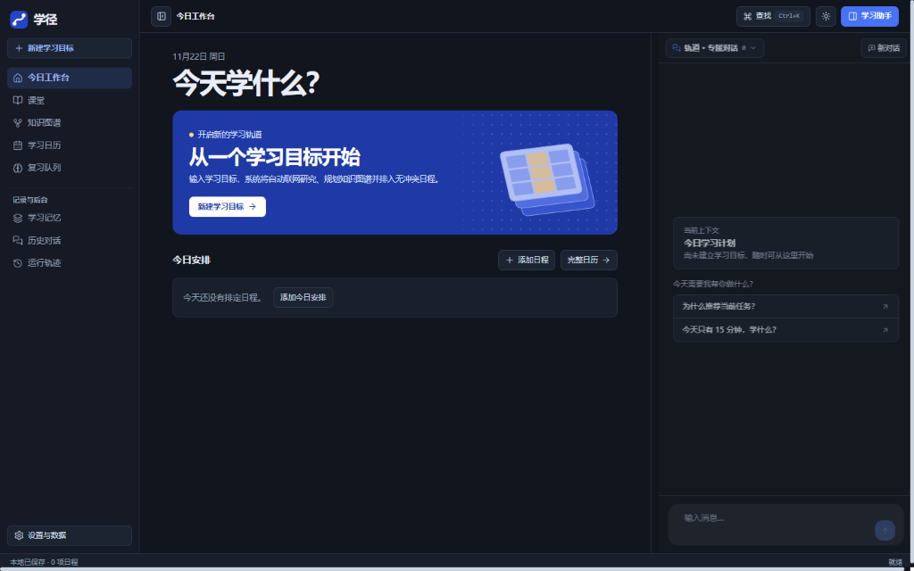
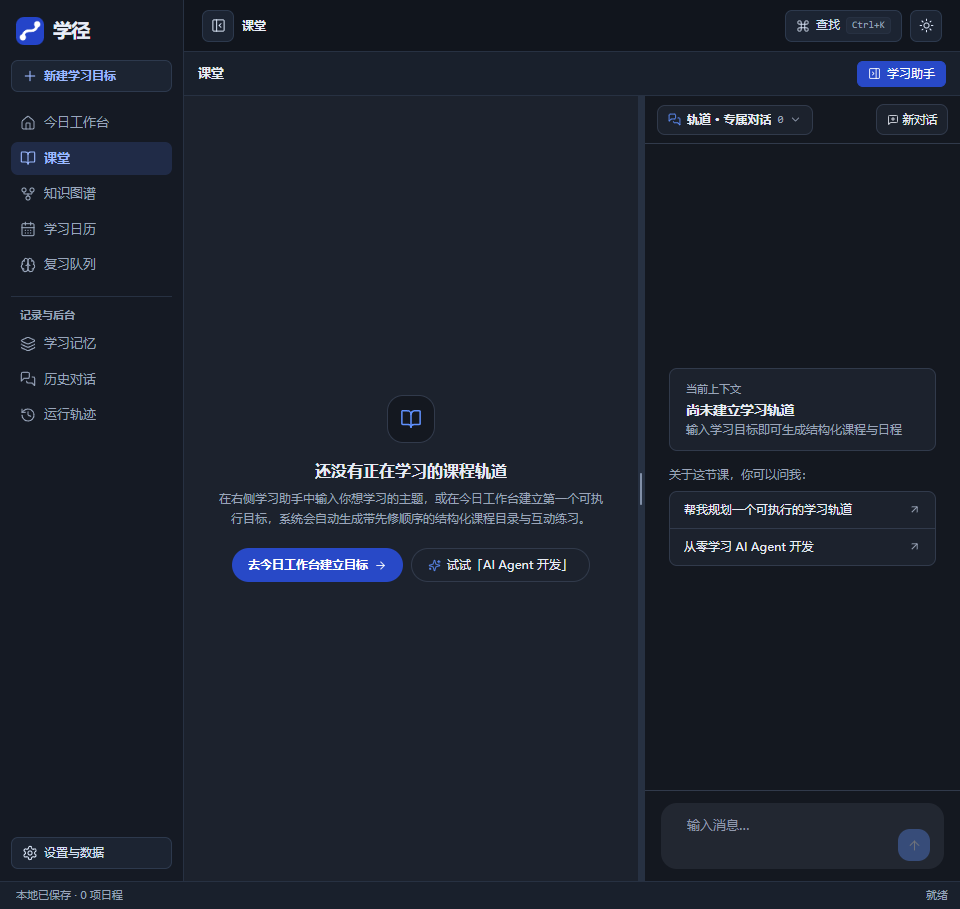
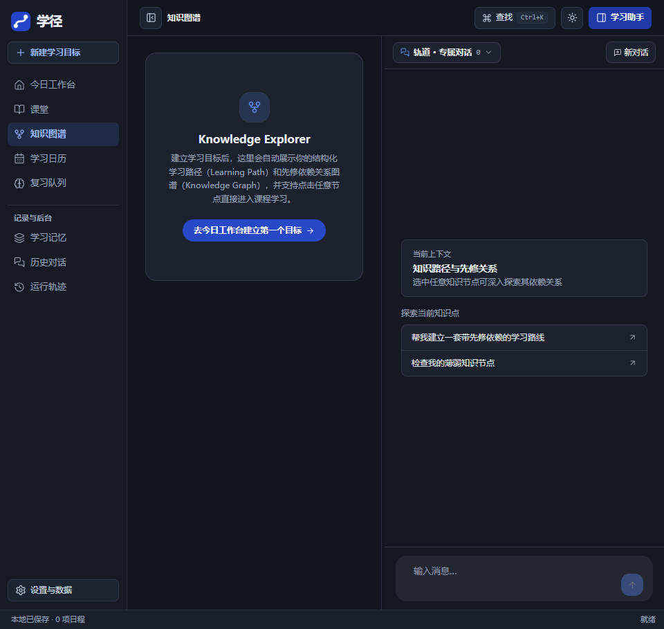
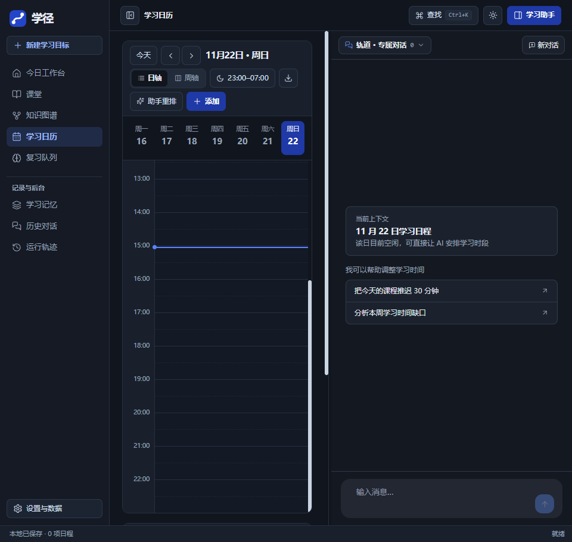
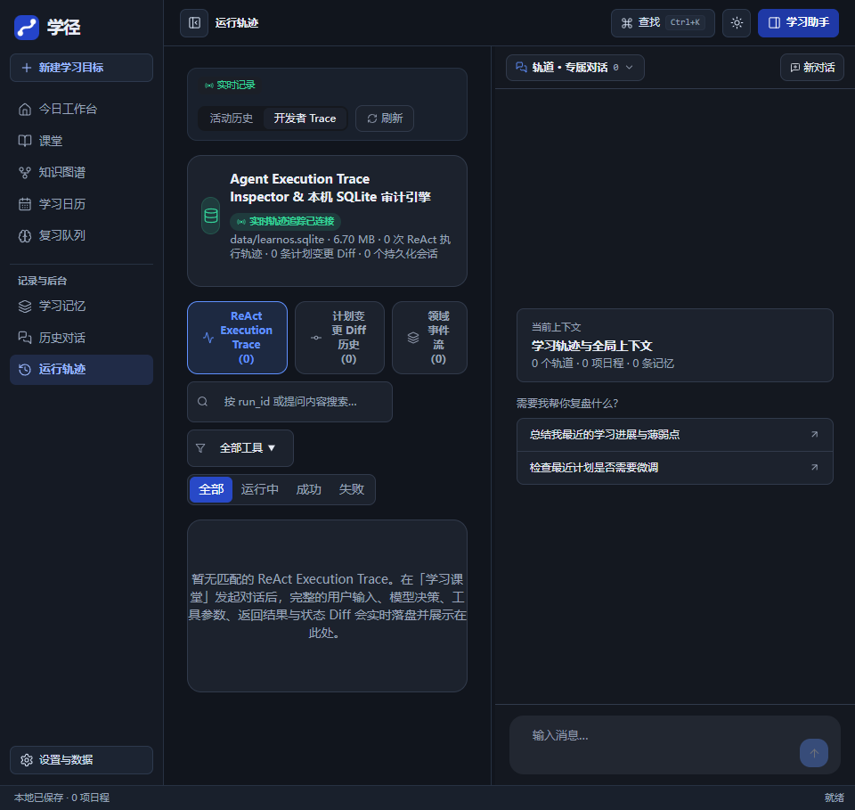
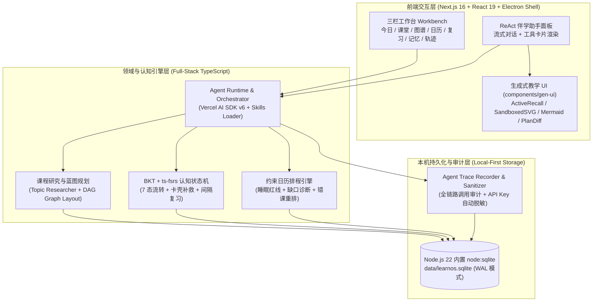

<div align="center">
  
  <h1>学径 XueJing · Personal AI Learning OS</h1>
  <p><strong>在知识地图与时间轴之间，专注当下这一步。</strong></p>
  <p>
    100% 全栈 TypeScript 构建的本机优先（Local-First）AI 个人学习工作台与智能伴学桌面系统<br/>
    Next.js 16 App Router · React 19 · Vercel AI SDK v6 · Tailwind CSS v4 · FSRS + BKT · Node.js 22 内置 SQLite · Electron
  </p>
</div>

---

## ✨ 项目简介

**学径（XueJing / LearnOS）** 是一款面向深度自学者与终身学习者的 **本机优先个人 AI 学习操作系统（Personal AI Learning OS）**。它将 **结构化课程规划**、**先修依赖知识图谱（DAG）**、**认知掌握度追踪（BKT + FSRS）**、**睡眠红线约束日历排程** 与 **苏格拉底式 ReAct 伴学 Agent** 融合在统一的三栏桌面工作台中。

- **零外部服务依赖**：基于 Node.js 22+ 内置 `node:sqlite`（WAL 模式），无需安装或配置 PostgreSQL、Neo4j、Redis 或 Docker。
- **100% 本机数据主权**：所有学习轨道、知识节点掌握度、日程安排、长期学习记忆、对话历史、计划变更 Diff 与 Agent 运行轨迹全部保存在本机单文件 `data/learnos.sqlite` 中，支持一键全量 JSON 备份恢复与 `.ics` 日历导出。
- **Web 与原生桌面双形态**：既可通过浏览器直接访问本地服务，也可通过 Electron 一键启动或打包为 Windows / macOS / Linux 原生桌面应用。
- **多模型直连与无密钥兜底**：支持 DeepSeek（含 `deepseek-chat` / `deepseek-reasoner` 思考模式）、OpenAI、Google Gemini、OpenRouter、Vercel AI Gateway 及本地 Ollama；未配置 API Key 时自动启用本地同构多步 ReAct 演示引擎。

---

## 🖼️ 应用界面预览

### 1. 今日工作台与 AI 伴学助手（三栏沉浸工作区）
左侧导航快速切换核心视图（支持 `Ctrl+1` ~ `Ctrl+8` 与 `Ctrl+K` 全局命令面板），中央聚焦当下学习目标与今日日程，右侧常驻上下文感知的「学习助手」伴学面板。



### 2. 沉浸式互动课堂（Classroom）
在课堂视图中围绕当前知识节点展开分步讲解、主动回忆测验（填空 / 单选 / 简答 / 代码练习）、可视化架构图解与课堂专注计时。



### 3. 动态 DAG 知识图谱（Knowledge Explorer）
自动进行先修依赖环检测与拓扑分层布局，直观呈现整个学习轨道的阶段路线、先修解锁关系与节点掌握度状态。



### 4. 学习日历与睡眠红线排程（Study Calendar）
支持日轴与周轴视图，严格保护睡眠红线（默认 `23:00–07:00` 绝不排课）与固定锁定时段，支持错课自动检测、AI 助手一键重排及标准 `.ics` 日历导出。



### 5. 运行轨迹与 SQLite 审计中心（Execution Trace Inspector）
实时追踪并持久化每一次 ReAct Agent 运行的完整思考链、工具调用参数、返回结果、耗时及状态变更 Diff（`+ 新增` / `调整 原时间 → 新时间` / `- 移除`）。



---

## 🚀 核心功能与技术亮点

### 1. Agent-Native 课程研究与生成工作流 (`lib/curriculum-planner.ts`, `lib/topic-researcher.ts`)
- **多步自治建课**：输入任意学习目标后，Agent 自动执行主题调研、构建具有先修依赖关系的 DAG 课程蓝图，并在睡眠红线与空闲窗口约束下自动排入日程。
- **结构化草案与确认机制**：建课与大规模重排均生成可视化预览卡片，支持一键落盘或按需微调。

### 2. 认知建模与 7 态教学状态机 (`lib/bkt-fsrs.ts`, `lib/pedagogy.ts`, `lib/learning-engine.ts`)
- **FSRS + BKT 双引擎融合**：结合官方 [`ts-fsrs`](https://github.com/open-spaced-repetition/ts-fsrs) 间隔重复算法（稳定性 Stability、难度 Difficulty、可提取性 Retrievability）与贝叶斯知识追踪（BKT 后验掌握概率更新）。
- **7 态学习者状态机**：每个知识节点在 `未解锁 (locked)`、`可学 (available)`、`进行中 (in_progress)`、`卡壳补救 (struggling)`、`已掌握 (mastered)`、`待复习 (review_due)` 与 `记忆衰退 (decaying)` 之间动态流转。
- **自适应补救与诊断跳过**：已掌握的先修节点支持「诊断跳过 (`skipAsMastered`)」并自动释放原排程时段；连续答错卡壳时自动触发降难补救块并顺延下游依赖课程。

### 3. 生成式教学 UI 与多语言代码沙盒 (`components/gen-ui/`, `lib/visual-explainer.ts`, `lib/labs.ts`)
- **丰富 Gen-UI 教学组件**：在对话流与课堂中原生渲染主动回忆测验卡（`ActiveRecallCard`）、沙盒化 SVG / Mermaid 动态图解（`VisualExplanationCard`）、知识路线阶段卡（`RoadmapStagesCard`）、遗忘曲线图（`RetentionCurveChart`）与计划变更对比卡（`PlanDiffCard`）。
- **内置 CodeMirror 代码练习环境**：支持 Python、Java、C++、JavaScript/TypeScript、SQL、HTML、CSS、JSON、Markdown 等语法高亮与即时规则校验。

### 4. 约束规划与超时节奏校准 (`lib/scheduler.ts`)
- **睡眠红线与可行性诊断**：默认锁定 `23:00–07:00` 睡眠红线，自动计算未来 7 天可用窗口与待排课负荷缺口（`FeasibilityAlertCard`）。
- **动态节奏校准 (`paceFactor`)**：课堂计时器（`SessionTimerBar`）记录实际学习耗时，自动校准后续排程的时长预估因子。

### 5. 带有效期 (TTL) 与置信度的长期记忆 (`lib/learning.ts`, `lib/context-manager.ts`)
- **智能提取与过期淘汰**：支持用户显式录入或由 Agent 从对话中提取学习偏好与临时约束（如「明后两天出差」「本周晚上加班」自动标记 `expiresAt`），过期记忆自动退出排程计算与大模型上下文。

### 6. 全链路可观测性与凭证脱敏 (`lib/db.ts`, `lib/agent-trace.ts`, `lib/trace-sanitizer.ts`)
- **100% 落盘可回放**：每次 Agent 推理步骤、工具调用与数据库实体变更均写入 `data/learnos.sqlite`。
- **内置隐私与密钥脱敏**：`trace-sanitizer` 自动拦截并脱敏 payload 中的 `apiKey`、`Authorization: Bearer ...`、`sk-*` 等敏感字段（替换为 `[REDACTED]`），且单条超大 payload 自动截断保护数据库性能。

---

## 🏗️ 系统架构



---

## ⚡ 快速开始

### 1. 环境要求
- **Node.js `>= 22.5.0`**（必须使用 Node.js 22+，项目直接使用 Node.js 内置的 `node:sqlite` 模块，无需任何 C++ 原生编译工具链）
- npm `>= 10`

### 2. 安装依赖

```bash
git clone https://github.com/mengliuyang123/xuejing-learning-os.git
cd xuejing-learning-os
npm install
```

### 3. 启动应用

#### 方式 A：Web 浏览器工作台（开发模式）

```bash
npm run dev
```

启动后在浏览器访问 `http://127.0.0.1:3000`（若 Windows 下 3000 端口被系统保留，可执行 `npx next dev --webpack --hostname 127.0.0.1 -p 5173` 并访问 `http://127.0.0.1:5173`）。

#### 方式 B：Web 生产构建与启动

```bash
npm run build
npm run start
```

生产服务默认监听 `http://127.0.0.1:5173`。

#### 方式 C：Electron 原生桌面客户端

```bash
# 直接以桌面客户端窗口启动
npm run desktop

# 打包免安装桌面目录 (输出至 dist-desktop/)
npm run desktop:pack

# 打包完整桌面安装包 (Windows NSIS & Portable / macOS DMG / Linux AppImage)
npm run desktop:dist
```

---

## 🔑 大模型接入与安全说明

学径支持两种大模型配置方式（**任选其一即可**，未配置时也可直接使用内置本地多步演示模式体验完整功能）：

### 方式一：应用内可视化配置（推荐）
1. 启动应用后，点击左下角 **「设置与数据」**（或快捷键 `Ctrl+,`）。
2. 选择模型服务商预设（支持 **DeepSeek / OpenAI / Google Gemini / OpenRouter / Vercel AI Gateway / 自定义 OpenAI 兼容端点（含 Ollama）**）。
3. 填入你的 API Key 并点击 **「测试连接」**。
4. **隐私说明**：通过界面配置的 API Key 仅保存在你本机的浏览器/桌面客户端 `localStorage`（`xushi.model-config.v1`）中，不会上传到任何第三方服务器。

### 方式二：`.env` 环境变量配置
复制项目根目录下的 [`.env.example`](./.env.example) 为 `.env`：

```bash
cp .env.example .env
```

编辑 `.env` 填入你自己的密钥：

```dotenv
OPENAI_BASE_URL=https://api.deepseek.com/v1
OPENAI_API_KEY=your_api_key_here
ATLAS_MODEL=deepseek-chat
```

> [!IMPORTANT]
> **API Key 安全保护机制**
> 1. `.gitignore` 已默认忽略 `.env`、`.env.*`（仅保留 `.env.example`）以及 `data/` 目录下的本机 SQLite 数据库文件，防止在 Git 提交时意外泄露密钥或个人学习数据。
> 2. 运行轨迹审计系统内置 `lib/trace-sanitizer.ts`，所有写入 SQLite 或通过 SSE 推送的 Trace 日志均会自动过滤并脱敏 `sk-*`、`Bearer`、`apiKey` 等敏感凭据。

---

## 📂 项目目录结构

```text
xuejing-learning-os/
├── app/                          # Next.js 16 App Router 页面与后端 API 路由
│   ├── api/
│   │   ├── agent/                # ReAct 伴学 Agent 核心对话与工具调用路由
│   │   ├── audit/                # 运行轨迹与实时 SSE Trace 审计流
│   │   ├── chats/                # 多会话与轨道专属对话持久化接口
│   │   ├── learning/             # 课堂准备、练习提交、计划草案与会话接口
│   │   ├── model-test/           # 多模型连通性即时测试接口
│   │   ├── state/                # 全局学习状态同步与迁移接口
│   │   ├── tasks/                # 后台异步 LLM 任务管理接口
│   │   ├── tracks/               # 学习轨道管理接口
│   │   └── workflows/            # 建课与研究工作流编排接口
│   ├── globals.css               # 全局设计系统变量与暗色/亮色主题样式
│   ├── layout.tsx                # 根布局与元数据
│   └── page.tsx                  # 工作台入口
├── components/                   # React 19 客户端组件
│   ├── gen-ui/                   # 生成式教学 UI 组件集 (测验卡、SVG/Mermaid 画布、计划 Diff 等)
│   ├── workbench/                # 三栏桌面工作台核心视图 (今日、课堂、图谱、日历、复习、记忆)
│   ├── ActivityAudit.tsx         # 运行轨迹与开发者 Trace 审计面板
│   ├── Agent.tsx                 # 右侧 AI 伴学助手面板
│   ├── KnowledgeFlowMap.tsx      # 交互式 DAG 知识图谱画布 (@xyflow/react)
│   ├── LearningStore.tsx         # 前端状态仓库与本机 SQLite 同步层
│   ├── ModelSettingsDialog.tsx   # 多模型配置与连接测试弹窗
│   └── Planner.tsx               # 日程规划与事件编辑器
├── electron/                     # Electron 桌面客户端主进程、预加载脚本与启动器
├── lib/                          # 核心领域算法与服务端基础设施
│   ├── agent-runtime.ts          # Agent 运行时与工具集编排
│   ├── agent-trace.ts            # ReAct 运行轨迹记录器
│   ├── bkt-fsrs.ts               # BKT 贝叶斯知识追踪 + ts-fsrs 间隔重复算法
│   ├── context-manager.ts        # 动态上下文预算分配与记忆注入
│   ├── curriculum-blueprint.ts   # 课程蓝图结构与校验
│   ├── curriculum-planner.ts     # 智能建课规划器
│   ├── db.ts                     # Node.js 22 内置 node:sqlite 存储引擎 (WAL 模式)
│   ├── deepseek-config.ts        # DeepSeek 思考模式与 OpenAI 兼容层适配
│   ├── graph.ts                  # DAG 环检测与拓扑分层布局算法
│   ├── learning-engine.ts        # 学习活动推进与状态流转核心引擎
│   ├── pedagogy.ts               # 7 态教学策略与补救决策引擎
│   ├── scheduler.ts              # 睡眠红线保护与约束日历排程引擎
│   ├── trace-sanitizer.ts        # 敏感密钥自动脱敏与超大负载截断
│   └── visual-explainer.ts       # 可视化图解生成与 SVG 安全清洗
├── public/                       # 应用图标与静态资源
├── skills/                       # Agent 内置领域技能定义 (visual-explainer 等)
├── tests/                        # 16 套全链路逻辑、算法、Trace 与端到端单元测试
├── docs/screenshots/             # 应用界面截图
├── .env.example                  # 环境变量配置模板（不含任何真实密钥）
├── electron-builder.yml          # Electron 跨平台打包配置
└── package.json                  # 项目依赖与脚本定义
```

---

## 🧪 测试与质量验证

项目内置完整的 TypeScript 类型检查与 16 套基于 Node.js 原生测试运行器（`node:test`）的单元测试套件，覆盖 SQLite 持久化、BKT/FSRS 认知算法、DAG 拓扑排序、睡眠红线排程、记忆 TTL、Trace 脱敏与并发隔离等核心逻辑：

```bash
# 1. TypeScript 严格类型检查
npm run typecheck

# 2. 运行全量领域逻辑与算法测试套件
npm run test:logic

# 3. 单独运行 ReAct Trace 审计与凭证脱敏测试
npm run test:trace

# 4. Next.js 生产构建验证
npm run build
```

---

## 📄 开源许可 (License)

本项目基于 [MIT License](https://opensource.org/licenses/MIT) 开源。
