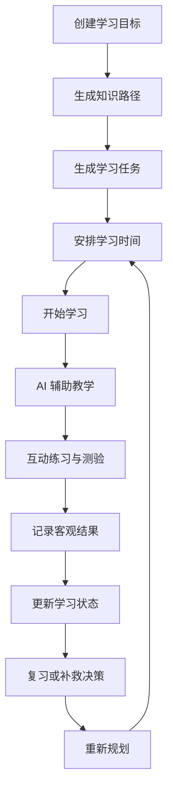

# 序时 LearnOS — 完整功能测试与端到端验收计划

**文档版本：** V2.0  
**产品名称：** 序时 LearnOS（Personal AI Learning OS）  
**产品类型：** Single-User / Local-First / AI-Native Desktop Application  
**技术栈：** TypeScript + SQLite + LLM Provider  
**当前 LLM：** DeepSeek（以实际配置为准）  
**测试范围：** 全功能、跨页面交互、端到端、Agent、学习科学、排程、持久化、安全、异常、性能和长期稳定性  
**建议文件名：** `LEARNOS_TEST_PLAN.md`

---

# 1. 产品定位与测试边界

## 1.1 产品定位

序时 LearnOS 是一个供单人使用的本地优先 AI 学习与时间管理桌面应用。

它不是：

- 多用户 SaaS。
- 团队协作学习平台。
- 传统 LMS。
- 单纯的 AI 聊天软件。
- 单纯的课程生成器。
- 单纯的日历管理器。

它的核心目标是：

**根据个人学习目标、知识掌握情况和真实可用时间，持续决定学什么、什么时候学、怎么学，并在实际情况变化时自动调整。**

系统应形成以下闭环：



## 1.2 本次测试的核心原则

1. 只考虑一个本地使用者。
2. 不进行跨用户隔离测试。
3. 不进行多租户与多人协作测试。
4. 保留多线程聊天测试，因为一个人仍可能同时拥有多个会话。
5. 保留并发任务测试，因为一个人仍可能同时运行多个 Agent Task。
6. 保留 SQLite 并发写入和幂等测试。
7. 保留本地数据备份、迁移和崩溃恢复测试。
8. 保留 LLM Provider 断网、超时和限流测试。
9. 保留个人隐私和本地文件安全测试。
10. 所有正式业务状态应以 SQLite 中的结构化数据为权威来源。

## 1.3 测试与功能现状的区分

本文中的测试分为两类：

**现有功能验证：** 根据当前界面和已展示的实际行为设计，用于检验已有功能是否正确。

**目标能力验收：** 用于检验最终希望系统具备的能力。如果当前版本没有实现，应记录为 `NOT_IMPLEMENTED`，不应把它伪装为已经通过，也不必一律认定为 Bug。

---

# 2. 测试管理规范

## 2.1 测试结果状态

| 状态 | 含义 |
|---|---|
| PASS | 实际结果符合全部预期 |
| FAIL | 实际结果与预期不符 |
| BLOCKED | 前置条件不满足，无法执行 |
| NOT_IMPLEMENTED | 该能力尚未实现 |
| NOT_RUN | 尚未测试 |
| PARTIAL | 只满足部分预期，需要进一步验证 |

## 2.2 Bug 严重程度

| 等级 | 定义 | 举例 |
|---|---|---|
| P0 | 数据损坏、未授权高风险操作或核心流程完全不可用 | SQLite 业务数据被破坏、已完成记录丢失 |
| P1 | 核心业务结果错误 | 错误评分、重复掌握度更新、后台任务被页面切换终止 |
| P2 | 功能可用但存在明显交互或状态问题 | 切换页面后草稿丢失、UI 状态刷新不及时 |
| P3 | 轻微体验问题 | 文字溢出、动画不流畅、边距不一致 |

## 2.3 每条失败用例必须保留的证据

- 测试 ID。
- 实际操作步骤。
- 预期结果。
- 实际结果。
- 截图或屏幕录像。
- 对应 Thread ID。
- 对应 Run ID（如有）。
- 对应 Task ID（如有）。
- 对应 Exercise ID / Attempt ID（如有）。
- 相关 SQLite 记录。
- ReAct Trace / Tool Call 参数及结果。
- 是否可稳定复现。
- 是否重启后仍存在。

---

# 3. 测试环境准备

## 3.1 环境记录

测试前填写：

```text
应用版本：
Git Commit：
操作系统：
桌面运行时：Electron / Tauri / 其他
Node.js 版本：
SQLite Schema 版本：
SQLite 数据文件：
LLM Provider：
LLM Model：
时区：
网络状态：
测试日期：
```

## 3.2 数据备份

执行任何测试前：

- [ ] 关闭正在进行的重要写入任务。
- [ ] 通过 SQLite 安全备份机制创建测试前快照。
- [ ] 确认备份能够打开并通过完整性检查。
- [ ] 在独立测试数据库上执行破坏性测试。
- [ ] 记录测试数据版本。
- [ ] 不在真实学习历史上运行批量删除或故障注入。

SQLite 如果开启 WAL 模式，不能仅在数据库正在写入时复制主 `.sqlite` 文件就假定备份完整。应使用 SQLite Backup API 或其他一致性备份方式。

## 3.3 标准测试资料

建议准备三个**场景配置**，它们不是三个不同的用户账号，而是同一人的三个可重置测试状态。

### Profile A：全新开始

```text
学习目标：AI Agent 开发
学习时长：45 分钟/天
知识掌握：全部未开始
学习轨道：不存在
日历学习任务：不存在
历史测验：不存在
```

### Profile B：已经开始学习

```text
学习目标：AI Agent 开发
学习时长：45 分钟/天
当前课程：Agent 是什么：LLM + 工具 + 循环
当前进度：学习中
历史测验：至少 2 条
已有学习轨道：6 节
已有排程：6 条
```

### Profile C：时间受限

```text
学习目标：AI Agent 开发
学习时长：15 分钟/天
固定工作：09:00–18:00
睡眠保护：23:00–07:00
部分日期：临时加班
课程预计时长：45 分钟
```

每个 Profile 应独立备份和恢复，避免一次测试留下的数据影响下一次测试。

## 3.4 标准六节课程

以当前已经展示的学习轨道为测试基准：

1. Agent 是什么：LLM + 工具 + 循环。
2. 调用 LLM 的最小闭环：messages 与角色。
3. 工具调用 Tool Calling：把函数交给模型。
4. ReAct 循环：Thought → Action → Observation。
5. 记忆与上下文：短期记忆、摘要与检索。
6. 实践：手写一个工具型最小 Agent。

测试时记录实际课程 ID、知识点 ID 和对应先修关系。

---

# 4. 全局端到端用户旅程

本章用于验证整个产品，而不是单独某个组件。

## E2E-001：首次启动与创建目标

**优先级：P0**

### 前置条件

恢复 Profile A。

### 操作步骤

1. 启动 LearnOS。
2. 进入 Today。
3. 检查首次使用界面。
4. 输入 `AI Agent 开发`。
5. 选择每天 `45 min`。
6. 点击规划按钮。
7. 观察是否进入目标澄清或学习诊断。
8. 回答已有编程基础、学习目的和学习偏好。
9. 点击「生成我的 Agent 学习路径」。
10. 等待后台 Agent 完成。
11. 查看 Today、Learn、Knowledge、Planner、Conversations、Activity。

### 预期结果

- [ ] 首次界面显示明确的目标创建入口。
- [ ] 不出现与当前状态无关的学习进度。
- [ ] 用户目标保存成功。
- [ ] 目标创建最多生成一个有效 Goal。
- [ ] 问卷答案被正确关联至目标。
- [ ] 生成六节课程。
- [ ] 每节课程有稳定 ID。
- [ ] 课程依赖关系正确。
- [ ] Planner 生成可执行的学习计划。
- [ ] Learn 显示第一节课程。
- [ ] Today 显示下一步行动。
- [ ] Activity 可以查看相关业务事件。
- [ ] 所有重要状态写入 SQLite。
- [ ] 没有重复生成相同学习轨道。

### 重点检查

如果连续点击两次生成按钮，不应该产生两条完全相同的轨道和十二条日程。

---

## E2E-002：点击开始学习

**优先级：P0**

### 操作步骤

1. 返回 Today。
2. 点击「开始学习」。
3. 观察跳转结果。
4. 检查 Learn 当前课程。
5. 检查右侧 AI Tutor。
6. 检查是否发生新的 LLM 请求。

### 预期结果

- [ ] 打开正确的 `lesson_id`。
- [ ] 自动建立或恢复 `learning_session_id`。
- [ ] 加载已有课程内容。
- [ ] 正确关联右侧 AI Tutor 上下文。
- [ ] 不创建重复课程。
- [ ] 不重复初始化学习状态。
- [ ] 切换页面后能恢复当前 Session。

### 设计验收要求

如果课程内容已经存在，打开课程不应该**必须**依赖重新向 LLM 发送“开始学习某某课程”的自然语言请求。

LLM 可用于补充个性化讲解，但正式课程 Session 的开启应由业务状态控制。

---

## E2E-003：AI Tutor 动态生成题目并注入 Learn

**优先级：P0**

这是序时 LearnOS 的核心差异化能力。

### 操作步骤

1. 在 Learn 打开第一节课。
2. 在右侧 AI Tutor 输入：

   `请给我一道关于 Agent 执行流程的排序练习。`

3. 等待 Agent 生成互动题。
4. 观察右侧聊天。
5. 观察左侧 Learn。
6. 确认是否出现相同题目。
7. 检查两个区域显示的题目 ID。
8. 在 Learn 中修改排序。
9. 切换到 Planner。
10. 返回 Learn。
11. 检查题目和答案是否恢复。

### 预期结果

- [ ] AI Tutor 可以生成新互动题。
- [ ] 题目经过结构校验。
- [ ] 题目具有唯一 Exercise ID。
- [ ] 题目关联当前课程。
- [ ] 题目关联当前 Learning Session。
- [ ] Learn 无需刷新即可显示新题。
- [ ] 切换页面后题目仍存在。
- [ ] 未提交答案可以恢复。
- [ ] AI Tutor 能知道该题是否已经生成。
- [ ] 不会对相同创建事件重复插入题目。
- [ ] 题目答案和评分规则已保存。
- [ ] Agent Trace 能追溯生成题目的工具调用。

### 特别检查：两个题目实例

如果右侧聊天和左侧 Learn 都出现可操作题目：

- [ ] 它们引用相同的逻辑题目。
- [ ] 不会产生两个互不关联的正式 Attempt。
- [ ] 任一位置完成后另一位置状态同步。
- [ ] 不会从两处重复更新掌握度。

### 推荐目标交互

右侧显示练习创建记录或引用卡片，左侧负责完整作答。

如果当前设计保留两处完整作答，则必须保证严格的共享状态和幂等提交。

---

## E2E-004：客观题正确答案测试

**优先级：P0**

### 标准排序题

题目：

一次 Agent 执行的简化流程应该如何排序？

- A：用户提出目标。
- B：LLM 选择下一步 Action。
- C：代码执行工具。
- D：工具结果作为 Observation 回填。
- E：LLM 根据新信息判断继续还是结束。

正确顺序：

`A → B → C → D → E`

### 测试数据

| ID | 输入 | 预期 |
|---|---|---|
| SORT-01 | A B C D E | 正确 |
| SORT-02 | C E D A B | 错误 |
| SORT-03 | A C B D E | 错误 |
| SORT-04 | A B D C E | 错误 |
| SORT-05 | A B C E D | 错误 |
| SORT-06 | 空答案 | 不允许提交 |
| SORT-07 | 缺少步骤 | 校验失败 |
| SORT-08 | 重复步骤 | 校验失败 |

### 预期结果

- [ ] 标准答案与题目版本一致。
- [ ] 评分结果确定且可复现。
- [ ] 系统识别错误位置。
- [ ] 不将错误顺序解释为正确。
- [ ] 提交后保存原始作答顺序。
- [ ] 反馈依据实际答案。
- [ ] 不由 LLM 自由编造客观题得分。

### 已发现风险复现

此前将 Final Answer 排在第二位的错误答案，被 AI 反馈解释为“识别出循环出口”。

本次必须重点检查：反馈是否真正依据用户提交的顺序，还是模型为了鼓励用户而作出不准确推断。

---

## E2E-005：左右两处同时提交同一题

**优先级：P0**

### 操作步骤

1. 让同一道题同时出现在 Learn 和 AI Tutor。
2. 在左侧修改答案。
3. 在右侧也修改答案。
4. 先点击左侧提交。
5. 立即点击右侧提交。
6. 检查前端反馈。
7. 检查 SQLite。
8. 检查 Agent Trace。

### 预期结果

- [ ] 明确采用哪个答案作为本次正式提交。
- [ ] 相同 Attempt 不会被正式评分两次。
- [ ] 已提交状态正确同步。
- [ ] 重复请求能够返回已有结果或明确拒绝。
- [ ] Learner State 只消费一次对应评估事件。
- [ ] FSRS 不会重复更新。
- [ ] Planner 不会重复创建补救任务。
- [ ] Activity 不会产生两次独立的业务成功记录。

---

## E2E-006：答错后的智能补救

**优先级：P0**

### 操作步骤

1. 在第一节课程提交错误排序。
2. 查看评分。
3. 查看薄弱点解释。
4. 检查掌握度。
5. 观察 AI 是否建议补救练习。
6. 点击补救练习。
7. 完成第二道不同类型题目。
8. 查看后续学习路径。
9. 打开 Planner。
10. 查看是否产生补救任务。

### 预期结果

- [ ] 保存错误 Attempt。
- [ ] 错误分析与作答一致。
- [ ] 更新的是实际相关知识点。
- [ ] 补救内容针对具体错误。
- [ ] 不无限重复相同题目。
- [ ] 没有足够证据时不会假装已准确诊断根因。
- [ ] 同一薄弱点不重复创建多个相同补救任务。
- [ ] 需要排程时先经过时间和依赖校验。
- [ ] 如果涉及修改既有计划，遵守当前授权策略。
- [ ] 所有正式状态更新可追踪。

---

## E2E-007：正确答题后的学习进展

**优先级：P0**

### 操作步骤

1. 完成第一节课程讲解。
2. 完成基础练习。
3. 完成独立测验。
4. 按课程既定标准达标。
5. 查看 Learner State。
6. 查看 Knowledge。
7. 查看 Today。
8. 查看 Planner。

### 预期结果

- [ ] 课程完成状态更新。
- [ ] 掌握状态按评估策略更新。
- [ ] 不把阅读完成等同于知识掌握。
- [ ] 达到解锁条件后开放下一节。
- [ ] 后续课程关联正确。
- [ ] 日历任务状态正确。
- [ ] Today 推荐新的下一步。
- [ ] 已完成课程不会无故重置。

---

## E2E-008：页面切换时 LLM 继续运行

**优先级：P0**

### 操作步骤

1. 在 Learn 发送较长请求：

   `详细讲解 ReAct Agent，并提供 Mermaid、Python 示例和互动题。`

2. 模型开始流式输出后立即切换 Planner。
3. 再切换 Knowledge。
4. 再切换 Today。
5. 打开右侧 AI 面板。
6. 返回 Learn。
7. 查看原对话。

### 预期结果

- [ ] 普通页面切换不取消 LLM Task。
- [ ] Task ID 保持不变。
- [ ] 后台任务持续执行。
- [ ] 返回后能够显示已生成内容。
- [ ] 流式增量没有重复。
- [ ] 不会重新创建同一请求。
- [ ] 最终回答保存成功。
- [ ] Activity 保留对应 Run。
- [ ] 正在学习的课程状态不受影响。

---

## E2E-009：关闭 AI Tutor 面板

**优先级：P0**

### 操作步骤

1. 发起一个较长的 LLM 请求。
2. 点击关闭右侧 AI Tutor。
3. 在 Learn 继续阅读课程。
4. 再次打开 AI Tutor。
5. 查看原任务。

### 预期结果

- [ ] 面板收起不取消任务。
- [ ] Learn 主区域正确扩展。
- [ ] 对话历史仍存在。
- [ ] 任务状态仍可查询。
- [ ] 打开后恢复原线程。
- [ ] 输入框草稿保持。
- [ ] 不重复发起 LLM 请求。

---

## E2E-010：最小化窗口和重新打开窗口

**优先级：P0**

### 操作步骤

1. 发起 LLM 生成任务。
2. 最小化桌面窗口。
3. 保持应用进程运行。
4. 恢复窗口。
5. 检查任务状态。
6. 关闭当前窗口，再根据桌面运行时的实际生命周期策略重新打开窗口。

### 预期结果

- [ ] 最小化不意外取消后台任务。
- [ ] 恢复窗口后数据显示正确。
- [ ] 如果关闭窗口会终止整个应用，任务安全转为中断或取消状态。
- [ ] 如果桌面运行时支持后台进程继续运行，窗口关闭后任务按配置继续。
- [ ] 不将已终止进程中的任务显示为仍在运行。
- [ ] 已持久化内容不会丢失。

---

## E2E-011：应用崩溃与重启

**优先级：P0**

### 操作步骤

1. 创建目标。
2. 生成课程。
3. 完成至少一道测验。
4. 修改计划。
5. 确认 SQLite 中已保存。
6. 在独立测试环境模拟异常退出。
7. 重新启动应用。
8. 检查全部页面。

### 预期结果

- [ ] Goal 仍然存在。
- [ ] Course 仍然存在。
- [ ] Learning Session 状态正确。
- [ ] 已提交 Attempt 不丢失。
- [ ] 掌握状态不重置。
- [ ] 日历计划可以恢复。
- [ ] 聊天历史完整。
- [ ] Agent Trace 可查询。
- [ ] 未完成 Task 状态准确。
- [ ] 不会重复执行已提交的写入操作。
- [ ] SQLite 完整性检查通过。

---

## E2E-012：不同聊天线程独立

**优先级：P0**

### 操作步骤

1. 新建课程讨论 A。
2. 讨论 Tool Calling。
3. 新建规划讨论 B。
4. 请求安排下周学习。
5. 新建自由讨论 C。
6. 询问与课程无关的问题。
7. 返回 A。
8. 检查线程内容和上下文。

### 预期结果

- [ ] A、B、C 分别有独立 Thread ID。
- [ ] 消息不串线。
- [ ] 规划工具不会把自由聊天当成课程作答。
- [ ] 课程讨论能够读取当前必要学习状态。
- [ ] 共享学习状态不等于共享全部聊天记录。
- [ ] 各线程可独立恢复生成状态。
- [ ] 删除聊天线程不会自动删除正式课程和评分数据。

---

## E2E-013：临时加班重新规划

**优先级：P0**

### 操作步骤

1. 在周三 20:00–20:45 安排一节课。
2. 新增周三 19:30–21:00 的工作事项。
3. 触发重新规划。
4. 查看 Planner。
5. 查看 Plan Diff。
6. 接受或拒绝新的计划。

### 预期结果

- [ ] 识别时间冲突。
- [ ] 工作事项不被擅自修改。
- [ ] 睡眠保护时间不被侵占。
- [ ] 能选择其他可用时间。
- [ ] 无可用时间时报告缺口。
- [ ] 不违反知识依赖。
- [ ] 旧计划版本保留。
- [ ] 新计划版本可追踪。
- [ ] 用户能够查看变更理由。
- [ ] 重复重排不会产生相同任务副本。

---

## E2E-014：学习超时重新规划

**优先级：P1**

### 操作步骤

1. 开始预计 45 分钟课程。
2. 实际学习 70 分钟。
3. 结束学习会话。
4. 检查实际时长。
5. 检查后续计划。

### 预期结果

- [ ] 正确保存 70 分钟实际时长。
- [ ] 保留原始预计时长。
- [ ] 不将超时直接判定为学习失败。
- [ ] 后续冲突可被识别。
- [ ] 有必要时重新规划。
- [ ] 不因一次超时就无依据地全面改变时间偏好。
- [ ] 用户能够理解变更原因。

---

## E2E-015：时间不足时的微学习

**优先级：P1**

### 操作步骤

1. 将可用时间设置为 15 分钟。
2. 当前新课预计需要 45 分钟。
3. 请求今天安排学习。
4. 检查候选任务。
5. 尝试安排完整课程。

### 预期结果

- [ ] 不把 45 分钟任务塞进 15 分钟时段。
- [ ] 能选择适合短时段的活动。
- [ ] 可拆分任务必须有明确分段边界。
- [ ] 不能仅通过截断课程正文假装完成。
- [ ] 无合适活动时明确报告。
- [ ] 计划时间符合实际约束。

---

## E2E-016：断网后的本地学习

**优先级：P1**

### 操作步骤

1. 预先生成课程及练习。
2. 断开网络。
3. 打开 Learn。
4. 阅读已保存课程。
5. 完成确定性客观题。
6. 查看已有 Planner 和 Knowledge。
7. 尝试向 LLM 提问。
8. 恢复网络。

### 预期结果

- [ ] 已保存课程可离线阅读。
- [ ] 已具备本地评分能力的客观题可离线提交。
- [ ] SQLite 能保存本地完成记录。
- [ ] 已有知识路径能够查看。
- [ ] 已有日历能够查看。
- [ ] LLM 请求明确显示离线错误。
- [ ] 不把网络故障当成用户学习失败。
- [ ] 恢复网络后不会重复提交既有成绩。

---

# 5. Today 页面测试

| ID | 操作 | 预期结果 | 优先级 |
|---|---|---|---|
| TODAY-01 | 第一次启动 | 显示目标创建表单 | P0 |
| TODAY-02 | 学习目标为空 | 禁止创建并提示 | P1 |
| TODAY-03 | 输入正常目标 | 正确创建 Goal | P0 |
| TODAY-04 | 选择 20 分钟 | 记录所选时间预算 | P1 |
| TODAY-05 | 选择 45 分钟 | 不影响其他个人设置 | P1 |
| TODAY-06 | 快速重复点击规划 | 不重复创建轨道 | P0 |
| TODAY-07 | 已有学习轨道 | 展示下一步行动 | P0 |
| TODAY-08 | 点击开始学习 | 打开正确 Lesson | P0 |
| TODAY-09 | 课程进行中返回 | 显示继续学习 | P1 |
| TODAY-10 | 完成课程返回 | 显示最新状态 | P0 |
| TODAY-11 | 复习到期 | 显示复习提醒 | P1 |
| TODAY-12 | 计划冲突 | 显示冲突信息 | P1 |
| TODAY-13 | 快速学习 15 分钟 | 返回可行活动 | P1 |
| TODAY-14 | 点击为什么推荐 | 展示真实决策依据 | P1 |
| TODAY-15 | 离线打开 Today | 显示本地缓存状态 | P1 |
| TODAY-16 | 切换当前学习目标 | 正确切换对应内容 | P1 |
| TODAY-17 | 没有今日任务 | 展示合理空状态 | P2 |
| TODAY-18 | 当天跨过午夜 | 今日日期与计划刷新正确 | P1 |

---

# 6. Learn 学习工作台测试

## 6.1 课程与导航

| ID | 操作 | 预期结果 |
|---|---|---|
| LEARN-01 | 无学习轨道时打开 | 正确显示空状态 |
| LEARN-02 | 从 Today 进入课程 | 定位正确课程 |
| LEARN-03 | 切换课程目录 | 读取对应内容 |
| LEARN-04 | 点击锁定课程 | 显示未满足条件 |
| LEARN-05 | 点击已完成课程 | 可回顾历史内容 |
| LEARN-06 | 切换学习模式 | 当前 Lesson 不变 |
| LEARN-07 | 切换课程时有未提交答案 | 明确保存或提示 |
| LEARN-08 | 返回原课程 | 恢复阅读位置 |
| LEARN-09 | 收起课程目录 | 主区布局自适应 |
| LEARN-10 | 展开 AI Tutor | 主内容不异常溢出 |

## 6.2 富内容渲染

| ID | 内容 | 预期结果 |
|---|---|---|
| RICH-01 | Markdown 标题 | 层级正确 |
| RICH-02 | Markdown 表格 | 可读且不溢出 |
| RICH-03 | Python 代码块 | 正确高亮 |
| RICH-04 | TypeScript 代码块 | 正确高亮 |
| RICH-05 | 复制代码 | 复制内容准确 |
| RICH-06 | Mermaid 流程图 | 正常渲染 |
| RICH-07 | Mermaid 时序图 | 正常渲染 |
| RICH-08 | Mermaid 语法错误 | 降级显示，不崩溃 |
| RICH-09 | 图片 | 能加载并显示来源 |
| RICH-10 | 图片加载失败 | 显示占位与重试 |
| RICH-11 | 超长文本 | 可正常滚动 |
| RICH-12 | 超宽代码 | 可滚动或展开 |
| RICH-13 | 不可信 HTML | 不执行危险脚本 |
| RICH-14 | 复杂公式 | 正确渲染或明确降级 |
| RICH-15 | AI 流式输出 Mermaid | 不因未完成语法频繁崩溃 |

## 6.3 教学模式

| ID | 操作 | 预期结果 |
|---|---|---|
| MODE-01 | Learn 模式 | 显示教学内容 |
| MODE-02 | Practice 模式 | 显示练习 |
| MODE-03 | Assess 模式 | 显示独立评估 |
| MODE-04 | Review 模式 | 显示到期复习 |
| MODE-05 | Learn → Practice | 内容和 Session 不丢失 |
| MODE-06 | Practice → Learn | 草稿按策略保留 |
| MODE-07 | Assess 失败 | 展示反馈与补救 |
| MODE-08 | Review 完成 | FSRS 状态更新 |
| MODE-09 | 课程未完成 | 不错误解锁下游 |
| MODE-10 | 完成全部达标条件 | 更新正式完成状态 |

---

# 7. AI Tutor 测试

## 7.1 上下文感知

| ID | 操作 | 预期结果 |
|---|---|---|
| TUTOR-01 | 在第一节提问 | AI 知道当前课程 |
| TUTOR-02 | 切换第二节 | 上下文切换正确 |
| TUTOR-03 | 对代码请求逐行解释 | 解释当前代码 |
| TUTOR-04 | 对 Mermaid 请求讲解 | 解释当前图 |
| TUTOR-05 | 在 Planner 提问 | 使用日历上下文 |
| TUTOR-06 | 在 Knowledge 提问 | 使用当前知识点 |
| TUTOR-07 | 在 Today 提问 | 使用当前目标与计划 |
| TUTOR-08 | 当前上下文不存在 | 不伪造已创建课程 |
| TUTOR-09 | 关闭 Tutor | 请求继续或正确取消 |
| TUTOR-10 | 打开 Tutor | 恢复线程和草稿 |

## 7.2 动态教学内容

| ID | 操作 | 预期结果 |
|---|---|---|
| GEN-01 | 请求生成排序题 | Learn 增加排序题 |
| GEN-02 | 请求生成选择题 | Learn 增加选择题 |
| GEN-03 | 请求生成代码填空 | Learn 增加代码题 |
| GEN-04 | 请求生成 Mermaid | Learn 展示合法图 |
| GEN-05 | 请求更简单的题 | 难度合理降低 |
| GEN-06 | 请求更难的题 | 难度合理提高 |
| GEN-07 | 请求另一种练习方式 | 生成不同题型 |
| GEN-08 | 生成相同题两次 | 不无意覆盖原题 |
| GEN-09 | 生成题目缺少评分规则 | 不进入正式评分 |
| GEN-10 | 题目生成失败 | 原课程保持可用 |
| GEN-11 | 课程切换期间生成完成 | 题目仍关联原课程 |
| GEN-12 | 用户主动删除候选练习 | 不误删正式成绩 |

---

# 8. 互动题型专项测试

## 8.1 单选题

- [ ] 正确答案得分正确。
- [ ] 错误答案有准确解释。
- [ ] 未选择时禁止提交。
- [ ] 同一次 Attempt 只能正式提交一次。
- [ ] 题目版本与答案版本一致。
- [ ] 切换页面后选择状态保留。

## 8.2 多选题

- [ ] 全部正确选项选中才判定完整正确，除非题目明确采用部分得分。
- [ ] 漏选能够识别。
- [ ] 错选能够识别。
- [ ] 部分得分规则预先定义。
- [ ] 反馈不把部分正确解释为完全掌握。

## 8.3 流程排序题

- [ ] 上移、下移操作正确。
- [ ] 每个步骤只出现一次。
- [ ] 键盘可完成排序。
- [ ] 提交时使用步骤 ID 而不是仅用显示文本。
- [ ] 正确顺序匹配可靠。
- [ ] 不同题目之间排序状态隔离。
- [ ] 两处显示同一题时状态同步。
- [ ] 评分与用户实际提交顺序一致。

## 8.4 代码填空题

- [ ] 输入框与正确答案位置正确。
- [ ] 多个空位可独立填写。
- [ ] 评分规则明确。
- [ ] 不错误忽略有意义的语法差异。
- [ ] 代码执行不在不安全环境中进行。
- [ ] 标准测试与评分结果可追踪。

## 8.5 代码改错题

- [ ] 用户可以编辑代码。
- [ ] 编辑内容自动暂存。
- [ ] 测试结果正确。
- [ ] 修复前后代码可对比。
- [ ] 测试超时能够处理。
- [ ] 不执行未经隔离的危险代码。

## 8.6 费曼解释题

- [ ] 有明确评价 Rubric。
- [ ] 区分事实错误、表达不清与理解不足。
- [ ] 模型评分附带依据。
- [ ] 不伪装成确定性的客观评分。
- [ ] 允许用户请求重新评价。
- [ ] 评分版本和模型信息可追踪。

---

# 9. Assessment Engine 测试

| ID | 测试 | 预期结果 | 优先级 |
|---|---|---|---|
| ASSESS-01 | 正确答案 | 正确评分 | P0 |
| ASSESS-02 | 错误答案 | 正确评分 | P0 |
| ASSESS-03 | 空答案 | 拒绝非法提交 | P1 |
| ASSESS-04 | 重复提交 | 不重复评分 | P0 |
| ASSESS-05 | 并发提交同一 Attempt | 至多一次正式生效 | P0 |
| ASSESS-06 | 不存在的 Exercise ID | 返回错误 | P1 |
| ASSESS-07 | Exercise 与 Lesson 不匹配 | 拒绝提交 | P0 |
| ASSESS-08 | 题目版本变化 | 旧 Attempt 保持可追溯 | P1 |
| ASSESS-09 | LLM 反馈与标准答案冲突 | 客观评分不变 | P0 |
| ASSESS-10 | SQLite 写入失败 | 不报告已保存 | P0 |
| ASSESS-11 | 已评分后重启 | 评分记录可恢复 | P0 |
| ASSESS-12 | 评分完成 | 产生唯一 AssessmentCompleted | P0 |

---

# 10. Learner Model 测试

## 10.1 掌握度状态

| ID | 场景 | 预期结果 |
|---|---|---|
| MASTER-01 | 首次开始 | 状态正确初始化 |
| MASTER-02 | 首次答对 | 按规则更新 |
| MASTER-03 | 首次答错 | 按规则更新 |
| MASTER-04 | 连续答对 | 体现更多掌握证据 |
| MASTER-05 | 连续答错 | 触发诊断或补救候选 |
| MASTER-06 | 重复消费相同 Attempt | 不重复更新 |
| MASTER-07 | 一次 LLM 回复声称已掌握 | 不直接覆盖状态 |
| MASTER-08 | 自我声明已掌握 | 与已验证掌握区分 |
| MASTER-09 | 用户跳过一节 | 不伪造测验结果 |
| MASTER-10 | 应用重启 | 状态恢复正确 |
| MASTER-11 | 估计器版本变化 | 有版本记录与迁移策略 |
| MASTER-12 | 缺少训练数据 | 不伪装成高置信度模型 |

## 10.2 掌握度与课程进度区别

必须单独检查：

- [ ] 阅读完成不等于掌握。
- [ ] 练习完成不等于掌握。
- [ ] 答对一道题不必然意味着完全掌握。
- [ ] 用户主动跳过不等于测验达标。
- [ ] 课程进度百分比与掌握概率不是同一个指标。
- [ ] BKT 输出若为估计值，应明确其含义和模型来源。
- [ ] 掌握状态变化有真实 Assessment 或其他可追踪证据。

---

# 11. FSRS 复习系统测试

| ID | 测试 | 预期结果 |
|---|---|---|
| FSRS-01 | 创建复习项目 | 初始化成功 |
| FSRS-02 | 完成一次复习 | 保存 Review Event |
| FSRS-03 | 选择 Again | 复习状态按算法更新 |
| FSRS-04 | 选择 Hard | 复习状态按算法更新 |
| FSRS-05 | 选择 Good | 复习状态按算法更新 |
| FSRS-06 | 选择 Easy | 复习状态按算法更新 |
| FSRS-07 | 查看下一次复习 | 日期来自算法结果 |
| FSRS-08 | 同一事件重复提交 | 不重复计算 |
| FSRS-09 | 未到期复习 | 状态正确 |
| FSRS-10 | 逾期复习 | 不自动认定完全遗忘 |
| FSRS-11 | 多个复习项目 | 独立更新 |
| FSRS-12 | 应用重启 | Review History 完整 |
| FSRS-13 | 当前时区变化 | 日期计算与显示正确 |
| FSRS-14 | LLM 自由提出复习日期 | 不覆盖权威 FSRS 数据 |
| FSRS-15 | 复习任务进入 Planner | 时间约束正常 |
| FSRS-16 | 复习完成后 | 不继续显示同一到期任务 |

注意：FSRS 不是整体知识掌握度模型，不能把复习稳定性直接当成课程掌握度。

---

# 12. Knowledge 知识路径测试

| ID | 操作 | 预期结果 |
|---|---|---|
| KNOW-01 | 打开学习路径 | 六节课显示正确 |
| KNOW-02 | 切换图谱视图 | 关系正确 |
| KNOW-03 | 点击知识节点 | 展示对应详情 |
| KNOW-04 | 点击先修节点 | 正确定位 |
| KNOW-05 | 点击后继节点 | 正确展示依赖 |
| KNOW-06 | 点击可学习节点 | 进入 Learn |
| KNOW-07 | 点击锁定节点 | 显示解锁要求 |
| KNOW-08 | 达标后刷新 | 正确解锁 |
| KNOW-09 | 测验失败 | 保持必要依赖限制 |
| KNOW-10 | 点击自报已掌握 | 不直接伪造正式评估 |
| KNOW-11 | 查询多跳依赖 | 返回正确节点 |
| KNOW-12 | 注入循环依赖 | 检测并拒绝无效 DAG |
| KNOW-13 | 图谱节点较多 | 操作流畅 |
| KNOW-14 | 删除学习轨道 | 确认并保护无关数据 |
| KNOW-15 | 切换目标 | 展示对应图谱 |

---

# 13. Planner 时间规划测试

## 13.1 基础日历

| ID | 操作 | 预期结果 |
|---|---|---|
| PLAN-01 | 打开日视图 | 当前日期正确 |
| PLAN-02 | 打开周视图 | 周范围正确 |
| PLAN-03 | 切换日期 | 正确加载事件 |
| PLAN-04 | 新建普通事件 | 成功保存 |
| PLAN-05 | 修改事件 | 正确更新 |
| PLAN-06 | 删除事件 | 删除范围明确 |
| PLAN-07 | 拖动事件 | 时间正确改变 |
| PLAN-08 | 修改持续时间 | 新结束时间正确 |
| PLAN-09 | 跨日事件 | 时间正确 |
| PLAN-10 | 导出 ICS | 数据与时区正确 |

## 13.2 时间约束

| ID | 场景 | 预期结果 |
|---|---|---|
| SCHED-01 | 课程与工作冲突 | 不自动覆盖工作 |
| SCHED-02 | 课程与睡眠冲突 | 拒绝不合法安排 |
| SCHED-03 | 两门课重叠 | 不生成冲突计划 |
| SCHED-04 | 课程时长大于可用时段 | 不能强行塞入 |
| SCHED-05 | 当日没有空闲 | 明确报告不可行 |
| SCHED-06 | 一周时间不足 | 报告时间缺口 |
| SCHED-07 | 先修未完成 | 不错误提前安排依赖课程 |
| SCHED-08 | 已完成课程 | 不重复安排新课 |
| SCHED-09 | 新增补救任务 | 检查整体可行性 |
| SCHED-10 | 复习到期 | 合理参与候选排程 |
| SCHED-11 | 用户锁定事件 | 自动重排不得移动 |
| SCHED-12 | 不可行方案 | 不输出看似成功的日程 |

## 13.3 Plan Diff 与审批

| ID | 场景 | 预期结果 |
|---|---|---|
| DIFF-01 | 新建计划 | 显示新增任务 |
| DIFF-02 | 移动课程 | 显示旧时间与新时间 |
| DIFF-03 | 删除学习时间块 | 显示删除原因 |
| DIFF-04 | 新增补救课程 | 显示来源 |
| DIFF-05 | 接受变更 | 新版本生效 |
| DIFF-06 | 拒绝变更 | 不应用草案 |
| DIFF-07 | 重复点击接受 | 不重复写入 |
| DIFF-08 | 再次重排 | 保留历史版本 |
| DIFF-09 | 查看变更原因 | 能关联事件或 Agent Run |
| DIFF-10 | 重排期间页面切换 | 任务不中断 |
| DIFF-11 | 旧草案已过期 | 提示重新计算 |
| DIFF-12 | 手动修改后再接受旧草案 | 检测版本冲突 |

---

# 14. Conversations 会话管理测试

**说明：这是单用户多线程，不是多用户测试。**

| ID | 操作 | 预期结果 |
|---|---|---|
| CONV-01 | 新建自由对话 | 唯一 Thread ID |
| CONV-02 | 新建课程对话 | 关联 Lesson |
| CONV-03 | 新建规划对话 | 关联 Goal 或 Plan |
| CONV-04 | 重命名对话 | 正确保存 |
| CONV-05 | 搜索会话 | 返回匹配结果 |
| CONV-06 | 按类型过滤 | 结果正确 |
| CONV-07 | 切换两个对话 | 历史独立 |
| CONV-08 | 一个线程生成中切换 | 原任务继续 |
| CONV-09 | 返回生成中的线程 | 继续显示结果 |
| CONV-10 | 删除聊天线程 | 正式成绩和日历不丢失 |
| CONV-11 | 归档线程 | 可恢复 |
| CONV-12 | 历史较长 | 不无限加载全部到模型 |
| CONV-13 | 原课程线程恢复 | 当前课程上下文正确 |
| CONV-14 | 多线程并发生成 | Task 和消息不混淆 |
| CONV-15 | 关闭应用重启 | 线程目录保留 |

---

# 15. LLM Task Manager 测试

| ID | 测试 | 预期结果 |
|---|---|---|
| TASK-01 | 发起一个请求 | 创建唯一 Task |
| TASK-02 | 正常完成 | 状态为 completed |
| TASK-03 | 请求失败 | 状态为 failed |
| TASK-04 | 用户取消 | 状态为 cancelled |
| TASK-05 | 页面切换 | 不影响 Task |
| TASK-06 | 面板关闭 | 不影响 Task |
| TASK-07 | 最小化应用 | 按策略继续 |
| TASK-08 | 应用关闭 | 正确终止或继续 |
| TASK-09 | 应用重启 | 中断任务状态正确 |
| TASK-10 | 两个任务并发 | 结果独立 |
| TASK-11 | 重复点击生成 | 根据幂等策略处理 |
| TASK-12 | Streaming 中断 | 不产生伪完成 |
| TASK-13 | 完成后重新订阅 | 恢复已有结果 |
| TASK-14 | 取消监听 | 不等于取消 Task |
| TASK-15 | Task 失败重试 | 产生明确的新尝试 |
| TASK-16 | 重试写入型工具 | 防止重复副作用 |
| TASK-17 | LLM 返回空结果 | 正确处理 |
| TASK-18 | 任务超时 | 能够恢复或报告 |
| TASK-19 | 全局状态栏 | 与真实 Task 状态一致 |
| TASK-20 | 任务历史 | 可查询和审计 |

---

# 16. ReAct Agent 测试

## 16.1 Tool Calling

| ID | 测试 | 预期结果 |
|---|---|---|
| AGENT-01 | 普通解释问题 | 无工具时可以直接回答 |
| AGENT-02 | 查询课程状态 | 调用正确工具 |
| AGENT-03 | 创建学习目标 | 调用对应工具 |
| AGENT-04 | 生成学习路径 | 创建成功且不重复 |
| AGENT-05 | 动态生成题目 | 返回结构化练习 |
| AGENT-06 | 保存长期记忆 | 有明确持久化结果 |
| AGENT-07 | 读取日历 | 返回当前数据 |
| AGENT-08 | 请求重新排程 | 正确调用 Planner |
| AGENT-09 | 参数 Schema 错误 | 拒绝或修正 |
| AGENT-10 | 不存在的工具名 | 不执行任意代码 |
| AGENT-11 | 工具返回错误 | 不报告成功 |
| AGENT-12 | 工具超时 | 有受控终止 |
| AGENT-13 | 多个工具调用 | 结果关联正确 |
| AGENT-14 | 达到最大步数 | 停止执行 |
| AGENT-15 | 达到预算 | 停止或降级 |
| AGENT-16 | 用户取消 | 不继续执行未授权操作 |
| AGENT-17 | 写工具重复调用 | 幂等 |
| AGENT-18 | 运行完成 | Final Response 与实际状态一致 |

## 16.2 ReAct Trace

每次 Run 应检查：

- [ ] Run ID。
- [ ] Thread ID。
- [ ] Provider / Model。
- [ ] User Input。
- [ ] Model Request。
- [ ] Model Response。
- [ ] Tool Call ID。
- [ ] Tool Name。
- [ ] Tool Arguments。
- [ ] Tool Execution Status。
- [ ] Tool Result。
- [ ] State Changes。
- [ ] Final Response。
- [ ] Duration。
- [ ] Token Usage（Provider 提供时）。
- [ ] Error（发生时）。
- [ ] 不泄漏 API Key。
- [ ] 不虚构模型未提供的内部推理内容。

---

# 17. Context Builder 与 Token 测试

这部分用于验证此前发现的三个问题：

1. 固定 `agent-main`。
2. 按消息条数截断而不按 Token 控制。
3. 历史工具大 JSON 反复重传。

| ID | 测试条件 | 预期结果 |
|---|---|---|
| CTX-01 | 连续 20 轮聊天 | 上下文受预算控制 |
| CTX-02 | 连续 50 轮聊天 | 不无限增长 |
| CTX-03 | 连续 100 轮聊天 | 摘要或裁剪生效 |
| CTX-04 | Tool 返回大型 JSON | 存储完整，模型获得必要精简信息 |
| CTX-05 | 旧 Tool Output | 后续轮次不无条件重传 |
| CTX-06 | 当前轮 Tool Call | 请求结果配对合法 |
| CTX-07 | 切换课程线程 | 不加载无关历史 |
| CTX-08 | 切换规划线程 | 加载必要时间约束 |
| CTX-09 | Learner State 更新 | 新请求能读到最新值 |
| CTX-10 | 模型上下文窗口较小 | 正确设置预算 |
| CTX-11 | 超预算 | 明确降级或报错 |
| CTX-12 | 重要 System Rule | 不被普通裁剪移除 |
| CTX-13 | 当前用户消息 | 不被静默删除 |
| CTX-14 | 摘要生成 | 不丢关键目标和约束 |
| CTX-15 | 摘要更新 | 不重复包含同一区间 |
| CTX-16 | Context Inspector | 可检查实际模型输入范围 |
| CTX-17 | 更换模型 | 重新适配 Token 预算 |
| CTX-18 | 工具 Schema 很大 | 计入上下文预算 |
| CTX-19 | 长课程正文 | 按当前任务选择相关片段 |
| CTX-20 | 长期使用后 | Token 用量曲线趋于可控 |

## 17.1 量化记录

选择同一个课程任务，对比第 1、10、30、50 轮的：

- Input Tokens。
- Output Tokens。
- Tool Result Tokens。
- 历史对话 Tokens。
- 摘要 Tokens。
- 模型响应延迟。
- Context Build 耗时。
- 回答质量。
- 课程状态正确性。

不能仅因为 Token 变少就判定成功，还必须确保关键上下文没有丢失。

---

# 18. Activity 与业务审计测试

| ID | 测试 | 预期结果 |
|---|---|---|
| ACT-01 | 查看历史活动 | 时间顺序正确 |
| ACT-02 | 点击 GoalCreated | 找到相关 Goal |
| ACT-03 | 点击 AssessmentCompleted | 找到对应 Attempt |
| ACT-04 | 点击 CalendarChanged | 找到相关事件 |
| ACT-05 | 点击 Plan Diff | 查看新旧版本 |
| ACT-06 | 查看 Agent Run | 打开完整 Trace |
| ACT-07 | Tool 失败 | 显示真实错误 |
| ACT-08 | 工具执行成功但数据库写入失败 | 显示实际业务失败 |
| ACT-09 | 一个业务动作产生多个底层事件 | 用户视图合理分组 |
| ACT-10 | 多次重试同一写入 | 不产生重复业务成功记录 |
| ACT-11 | 搜索 Run ID | 返回正确结果 |
| ACT-12 | 筛选工具 | 正确过滤 |
| ACT-13 | 查看模型响应 | 与实际记录一致 |
| ACT-14 | 删除某个会话 | 审计保留策略一致 |
| ACT-15 | 应用重启 | 历史仍可查 |
| ACT-16 | 事件 Payload 过大 | 展示受控摘要和详情 |
| ACT-17 | Trace 包含私密数据 | 正确脱敏 |
| ACT-18 | Plan Diff 对应 Agent Run | 关联关系正确 |

---

# 19. 长期记忆测试

| ID | 场景 | 预期结果 |
|---|---|---|
| MEM-01 | 保存学习目标 | 结构化保存 |
| MEM-02 | 保存编程背景 | 可查询 |
| MEM-03 | 保存学习偏好 | 有来源 |
| MEM-04 | 重复保存相同事实 | 不产生无意义副本 |
| MEM-05 | 修改学习偏好 | 新状态生效 |
| MEM-06 | 删除某条记忆 | 按删除策略生效 |
| MEM-07 | 明确纠正错误记忆 | 旧内容不继续作为当前事实 |
| MEM-08 | 切换聊天线程 | 相关长期记忆可检索 |
| MEM-09 | 无关任务 | 不注入全部记忆 |
| MEM-10 | 一次临时行为 | 不直接推断为永久偏好 |
| MEM-11 | 应用重启 | 记忆可恢复 |
| MEM-12 | Trace 查看保存过程 | 有来源和状态变化 |
| MEM-13 | 记忆与当前课程冲突 | 有确定的优先级规则 |
| MEM-14 | 记忆数据导出 | 数据完整 |
| MEM-15 | 删除学习目标 | 不误删无关记忆 |

---

# 20. SQLite 本地持久化测试

| ID | 场景 | 预期结果 |
|---|---|---|
| DB-01 | 新建 Goal | 正确写入 |
| DB-02 | 新建 Learning Track | 正确关联 Goal |
| DB-03 | 新建 Lesson | ID 唯一 |
| DB-04 | 创建 Exercise | 正确关联 Lesson |
| DB-05 | 提交 Attempt | 正确关联 Exercise |
| DB-06 | 更新 Learner State | 正确关联 Concept |
| DB-07 | 创建 Review Event | 正确关联 Review Item |
| DB-08 | 创建 Calendar Event | 正确关联计划 |
| DB-09 | 生成 Plan Version | 版本递增正确 |
| DB-10 | 创建 Agent Run | 正确关联 Task / Thread |
| DB-11 | 保存 Tool Result | 可查询 |
| DB-12 | 同一写操作重试 | 幂等 |
| DB-13 | 写入失败 | 不报告持久化成功 |
| DB-14 | 并发短事务 | 不错误覆盖状态 |
| DB-15 | 数据库被短暂锁定 | 有合理的 busy 处理 |
| DB-16 | 异常退出 | 已提交事务完整 |
| DB-17 | 应用升级 | Migration 成功 |
| DB-18 | 数据库备份 | 可恢复 |
| DB-19 | 数据库导出 | 关键对象完整 |
| DB-20 | 数据完整性检查 | 无损坏或外键异常 |
| DB-21 | 错误 Schema 版本 | 明确阻止不安全启动 |
| DB-22 | 数据库路径不可写 | 反馈明确 |
| DB-23 | 磁盘空间不足 | 不伪装保存成功 |
| DB-24 | 删除学习轨道 | 遵循明确的关联数据删除规则 |
| DB-25 | 恢复测试快照 | 数据与状态一致 |

---

# 21. 桌面应用专项测试

| ID | 操作 | 预期结果 |
|---|---|---|
| DESK-01 | 首次启动 | 正常显示 |
| DESK-02 | 冷启动已有数据库 | 正常恢复 |
| DESK-03 | 最小化窗口 | 运行策略正确 |
| DESK-04 | 最大化窗口 | 布局正常 |
| DESK-05 | 缩小窗口 | 功能仍可访问 |
| DESK-06 | 调整面板宽度 | 无明显布局错误 |
| DESK-07 | 收起 AI Tutor | 主区域扩展 |
| DESK-08 | 展开 AI Tutor | 恢复状态 |
| DESK-09 | 连续切换六个页面 | 无严重卡顿 |
| DESK-10 | 长时间打开应用 | 无明显资源泄漏 |
| DESK-11 | 系统休眠 | 恢复后任务状态准确 |
| DESK-12 | 系统唤醒 | 日程与任务状态刷新 |
| DESK-13 | 系统时区变化 | 时间显示正确 |
| DESK-14 | 跨午夜使用 | 日期正确更新 |
| DESK-15 | 多窗口（如果支持） | 状态同步与写入安全 |
| DESK-16 | 应用关闭 | 重要草稿安全处理 |
| DESK-17 | 应用重启 | 工作状态恢复 |
| DESK-18 | 关闭后再次打开 | 不重复启动后台任务 |
| DESK-19 | 新版本升级 | 原数据完整 |
| DESK-20 | 重置应用 | 明确确认且可按策略备份 |

---

# 22. 安全与隐私测试

单用户不意味着完全不需要安全措施。

重点是本地数据、凭据、外部资源和 Agent 的操作权限。

| ID | 测试 | 预期结果 |
|---|---|---|
| SEC-01 | API Key 存储 | 不明文展示在 UI 日志中 |
| SEC-02 | Trace 查看 | 凭据被脱敏 |
| SEC-03 | 恶意 Prompt 注入 | 不越过工具权限 |
| SEC-04 | Tool Result 包含指令 | 不作为系统指令执行 |
| SEC-05 | 课程 Markdown 包含脚本 | 不执行危险脚本 |
| SEC-06 | Mermaid 包含恶意内容 | 安全渲染 |
| SEC-07 | 外部图片 | 不执行主动脚本 |
| SEC-08 | LLM 输出 SQL | 不直接任意执行 |
| SEC-09 | LLM 输出 Shell 命令 | 不未经授权执行 |
| SEC-10 | 用户代码练习 | 隔离执行或不执行 |
| SEC-11 | Agent 请求删除本地文件 | 必须受权限策略约束 |
| SEC-12 | 自动修改日历 | 遵守授权 |
| SEC-13 | 删除学习记录 | 明确确认范围 |
| SEC-14 | 备份文件 | 不意外暴露密钥 |
| SEC-15 | 导出诊断日志 | 隐私内容按策略脱敏 |
| SEC-16 | 非法本地文件路径 | 不可任意读取系统敏感文件 |

---

# 23. 故障注入测试

| ID | 故障 | 预期结果 |
|---|---|---|
| FAIL-01 | 断网 | LLM 正确报错 |
| FAIL-02 | Provider 429 | 受控重试或提示 |
| FAIL-03 | Provider 500 | 不无限重试 |
| FAIL-04 | 请求超时 | Task 状态正确 |
| FAIL-05 | 模型输出非法 JSON | 校验失败 |
| FAIL-06 | Tool 参数缺失 | 不执行不合法操作 |
| FAIL-07 | Tool 返回异常 | Trace 正确记录 |
| FAIL-08 | 练习缺少标准答案 | 不进入客观自动评分 |
| FAIL-09 | SQLite 写入错误 | 不报告成功 |
| FAIL-10 | 数据库暂时锁定 | 合理等待或报错 |
| FAIL-11 | 磁盘空间不足 | 有明确反馈 |
| FAIL-12 | 关闭应用时有运行任务 | 正确处理 |
| FAIL-13 | 重启发现旧 Running Task | 正确标记或恢复 |
| FAIL-14 | 用户快速切换课程 | 不出现数据串线 |
| FAIL-15 | 两个任务修改同一计划 | 有版本冲突处理 |
| FAIL-16 | 重复 Tool 回调 | 不重复写入 |
| FAIL-17 | 生成课程中途失败 | 不留下伪完成课程 |
| FAIL-18 | 生成题目中途失败 | 不留下可错误评分的半成品 |
| FAIL-19 | Planner 无解 | 报告不可行 |
| FAIL-20 | Agent 步数耗尽 | 安全停止 |
| FAIL-21 | Context 超过预算 | 不盲目发送全量 |
| FAIL-22 | 流式输出中断 | 保存已收到内容并标记状态 |
| FAIL-23 | 用户取消任务 | 不继续执行未授权后续工具 |
| FAIL-24 | 保存成功但响应丢失 | 重试不产生重复副作用 |

---

# 24. 性能与长时间稳定性

## 24.1 建议性能目标

以下阈值是初步参考，必须根据实际桌面设备和应用规模校准。

| 指标 | 建议目标 |
|---|---|
| 普通页面点击响应 | P95 小于 200ms |
| 本地页面切换 | 尽量小于 300ms |
| 同一 Attempt 重复正式提交 | 0 |
| 未授权硬约束违反 | 0 |
| 页面切换导致 LLM 意外取消 | 0 |
| 已提交学习记录丢失 | 0 |
| 已完成 Task 被重复执行写操作 | 0 |
| 长历史上下文预算超限 | 0 次无保护调用 |

## 24.2 性能用例

| ID | 测试 | 预期结果 |
|---|---|---|
| PERF-01 | 100 条聊天记录 | 正常滚动 |
| PERF-02 | 1000 条聊天记录 | 分页或虚拟化有效 |
| PERF-03 | 100 道互动练习 | 无严重卡顿 |
| PERF-04 | 多个 Mermaid 图 | 不持续阻塞 UI |
| PERF-05 | 100 个知识点 | 图谱可用 |
| PERF-06 | 200 个日历事件 | 操作流畅 |
| PERF-07 | 长文本 Streaming | 不频繁整体重绘 |
| PERF-08 | 同时运行两个 LLM Task | UI 仍可操作 |
| PERF-09 | 连续切换页面 100 次 | 状态正确 |
| PERF-10 | 应用持续运行 4 小时 | 无明显内存持续增长 |
| PERF-11 | 连续完成 20 次测验 | 无重复评分 |
| PERF-12 | 反复生成和撤销计划 | 版本与数据一致 |
| PERF-13 | 长上下文持续聊天 | Token 受控 |
| PERF-14 | 数据库增长至较大规模 | 查询仍满足产品需要 |

---

# 25. UI、动画与可访问性测试

| ID | 操作 | 预期结果 |
|---|---|---|
| UX-01 | Tab 导航 | 焦点顺序合理 |
| UX-02 | Enter 提交 | 不意外重复提交 |
| UX-03 | Esc 关闭弹窗 | 正常关闭 |
| UX-04 | 键盘排序题 | 可完成作答 |
| UX-05 | 缩小窗口 | 内容不不可用 |
| UX-06 | 放大字体 | 重要内容不截断 |
| UX-07 | 长课程标题 | 有完整查看入口 |
| UX-08 | 长代码块 | 可水平滚动 |
| UX-09 | AI 面板展开 | 不遮挡关键按钮 |
| UX-10 | AI 面板收起 | 主区正常扩展 |
| UX-11 | 左右滚动区域 | 不意外串联滚动 |
| UX-12 | 页面过渡 | 不闪烁 |
| UX-13 | 动态题目插入 | 不突然跳走正在阅读的位置 |
| UX-14 | 测验提交 | 有加载、成功、失败状态 |
| UX-15 | 计划重排 | 新旧时间变化清晰 |
| UX-16 | prefers-reduced-motion | 减少非必要动画 |
| UX-17 | 错误提示 | 不只通过颜色区分 |
| UX-18 | 后台任务完成通知 | 不阻断当前作答 |
| UX-19 | 新题目出现 | 有明确的新内容提示 |
| UX-20 | 页面刷新或恢复 | 保持合适滚动位置 |

---

# 26. 业务数据一致性测试

## 26.1 权威状态划分

| 数据 | 权威来源 |
|---|---|
| 学习目标 | Goal Service / SQLite |
| 当前课程 | Learning Session |
| 题目定义 | Exercise Store |
| 正式答题结果 | Assessment Engine |
| 掌握状态 | Learner Model |
| FSRS 状态 | Review Engine |
| 日程 | Planner / Calendar Store |
| 计划版本 | Plan Version Store |
| 对话历史 | Conversation Store |
| Agent 执行状态 | Task Manager |
| Agent 审计 | Trace Store |

## 26.2 一致性测试

| ID | 场景 | 预期结果 |
|---|---|---|
| DATA-01 | Today 创建目标 | Learn 读取同一 Goal |
| DATA-02 | Learn 打开课程 | Knowledge 正确定位 |
| DATA-03 | Tutor 生成题目 | Learn 读取同一 Exercise |
| DATA-04 | 提交题目 | Assessment 正确关联 |
| DATA-05 | 更新掌握度 | Knowledge 正确显示 |
| DATA-06 | FSRS 到期 | Today 正确提醒 |
| DATA-07 | Planner 重排 | Today 显示新时间 |
| DATA-08 | Plan Diff | Activity 能追溯 |
| DATA-09 | Chat 删除 | 不误删评估历史 |
| DATA-10 | App 重启 | 全部权威状态恢复 |
| DATA-11 | 重复事件 | 无重复业务结果 |
| DATA-12 | 同一事件跨模块传播 | 最终状态一致 |
| DATA-13 | 正在执行时切换学习目标 | 运行结果归属原目标 |
| DATA-14 | 学习计划过期后提交 | 需要冲突检测 |
| DATA-15 | 课程内容版本变化 | 历史 Attempt 不失去评分依据 |

---

# 27. 综合场景测试

## SCENARIO-A：正常学习完整闭环

**目标：** 验证最理想的学习流程。

1. 创建学习目标。
2. 生成六节课轨道。
3. 生成六个学习时间块。
4. Today 显示第一节。
5. 点击开始学习。
6. Learn 加载课程。
7. Tutor 动态生成练习。
8. 用户正确作答。
9. Assessment 保存结果。
10. Learner Model 更新状态。
11. Knowledge 更新进度。
12. Planner 更新后续安排。
13. Activity 记录操作。
14. 关闭并重启应用。

**预期效果：**

- [ ] 全流程无需重新创建目标。
- [ ] 课程、练习和日历一致。
- [ ] 评分正确。
- [ ] 无重复事件。
- [ ] 无状态丢失。
- [ ] 所有数据可恢复。

## SCENARIO-B：多次失败后的自适应教学

**目标：** 验证真正的补救学习，而非重复生成内容。

1. 打开第一节。
2. 故意答错排序题。
3. 查看薄弱点解释。
4. AI 生成代码填空补救题。
5. 用户再次答错。
6. 系统判断需要进一步指导。
7. AI 提供 Worked Example。
8. 再生成新的独立练习。
9. 用户完成练习。
10. 重新评估。
11. 检查掌握状态。
12. 检查 FSRS。
13. 检查 Planner。

**预期效果：**

- [ ] 每次评分依据真实作答。
- [ ] 补救题与薄弱点相关。
- [ ] 不无限重复同一题。
- [ ] 不凭空提高掌握度。
- [ ] 不重复生成补救日程。
- [ ] 未满足先修条件时不错误解锁。
- [ ] 用户能理解为什么推荐补救。

## SCENARIO-C：现实时间变化

**目标：** 验证时间与学习内容联合规划。

1. 创建六节课程。
2. 每天安排 45 分钟。
3. 周一完成第一节。
4. 周二临时加班。
5. 周三学习超时。
6. 周四测验失败。
7. 周五只有 15 分钟。
8. 周末增加不可移动私人事项。
9. 请求重新规划。
10. 查看全部计划变更。
11. 接受新的可行计划。
12. 继续学习。

**预期效果：**

- [ ] 不产生非法时间冲突。
- [ ] 不侵占睡眠。
- [ ] 不违反知识依赖。
- [ ] 已完成任务保持完成。
- [ ] 未完成任务根据状态重新安排。
- [ ] 短时间优先选择适合的完整学习活动。
- [ ] 无法满足期限时明确报告。
- [ ] Plan Diff 与最终计划一致。

## SCENARIO-D：长时间使用和多线程

**目标：** 验证单人长期使用的上下文管理。

1. 创建课程讨论线程。
2. 连续学习三节课。
3. 每节多次请求 AI 讲解。
4. 创建规划讨论线程。
5. 调整学习时间。
6. 创建自由聊天线程。
7. 询问无关问题。
8. 返回第三节课程。
9. 完成一次测验。
10. 查看 Context Inspector。
11. 查看 Token Usage。
12. 重启应用。

**预期效果：**

- [ ] 不同线程历史独立。
- [ ] 正式学习状态共享且正确。
- [ ] 模型不会无条件加载全部历史。
- [ ] 大型旧工具结果不重复注入。
- [ ] Token 不无限增长。
- [ ] 学习进度无丢失。
- [ ] 重启后恢复正确。

## SCENARIO-E：后台 Agent 与桌面生命周期

**目标：** 验证类似 Codex Desktop 的后台任务体验。

1. 在 Learn 请求生成复杂课程。
2. LLM 开始 Streaming。
3. 切换 Planner。
4. 新建一个普通日程。
5. 切换 Knowledge。
6. 收起 AI 面板。
7. 最小化窗口。
8. 恢复窗口。
9. 查看任务进度。
10. 打开 Activity。
11. 查看完整 Run。
12. 返回 Learn。

**预期效果：**

- [ ] 后台生成正常。
- [ ] UI 不阻塞。
- [ ] 课程数据没有错误覆盖。
- [ ] Task 结果归属正确。
- [ ] Trace 完整。
- [ ] 页面切换没有引发重复执行。

## SCENARIO-F：离线和故障恢复

**目标：** 验证 Local-First 能力。

1. 启动已有学习轨道。
2. 断开网络。
3. 阅读课程。
4. 完成一题确定性客观题。
5. 查看知识路径。
6. 查看日历。
7. 尝试调用 LLM。
8. 观察错误提示。
9. 恢复网络。
10. 重新调用 LLM。
11. 检查本地成绩。
12. 重启应用。

**预期效果：**

- [ ] 本地已有数据可以使用。
- [ ] 本地可评分题型仍可完成。
- [ ] 网络失败不破坏正式数据。
- [ ] 恢复网络不重复提交。
- [ ] 历史状态正确。

---

# 28. 发布验收门槛

## 28.1 必须通过的核心测试

- [ ] E2E-001 首次创建目标。
- [ ] E2E-002 正确进入课程。
- [ ] E2E-003 动态生成练习。
- [ ] E2E-004 客观题评分。
- [ ] E2E-005 防止重复提交。
- [ ] E2E-006 自适应补救。
- [ ] E2E-007 学习进度更新。
- [ ] E2E-008 页面切换不中断 LLM。
- [ ] E2E-009 AI 面板收起不中断任务。
- [ ] E2E-011 崩溃与重启恢复。
- [ ] E2E-012 多线程隔离。
- [ ] E2E-013 日历冲突重排。
- [ ] E2E-016 离线本地学习。
- [ ] SQLite 完整性验证。
- [ ] Agent Trace 数据可追溯。

## 28.2 发布阻断条件

出现以下问题时，不建议将版本标记为稳定：

- 正式测验评分错误。
- 重复提交导致重复掌握度更新。
- 课程或日历数据丢失。
- 页面切换导致正在运行的 Agent 意外终止。
- 后台任务结果写入错误课程。
- 未授权修改不可移动日程。
- 学习计划存在未处理的硬约束冲突。
- SQLite 升级迁移破坏旧数据。
- 工具重试造成重复写入。
- 系统报告完成但实际操作失败。

---

# 29. 测试结果记录模板

每完成一条测试，复制下面模板填写。

## Test Report

**测试 ID：**  
**测试名称：**  
**测试时间：**  
**应用版本：**  
**测试 Profile：** A / B / C

### 操作步骤

1.
2.
3.

### 预期结果

### 实际结果

### 测试状态

PASS / FAIL / BLOCKED / NOT_IMPLEMENTED / NOT_RUN / PARTIAL

### Bug 严重程度

P0 / P1 / P2 / P3

### 证据

- 截图：
- 视频：
- Run ID：
- Thread ID：
- Task ID：
- Exercise ID：
- Attempt ID：
- SQLite 记录：
- Trace 记录：

### 复现条件

### 原因分析

### 修复建议

### 回归测试结果

---

# 30. 测试汇总表

| 模块 | PASS | FAIL | PARTIAL | NOT_IMPLEMENTED | NOT_RUN |
|---|---:|---:|---:|---:|---:|
| Today | | | | | |
| Learn | | | | | |
| AI Tutor | | | | | |
| Rich Content | | | | | |
| Interactive Exercises | | | | | |
| Assessment | | | | | |
| Learner Model | | | | | |
| FSRS | | | | | |
| Knowledge | | | | | |
| Planner | | | | | |
| Conversations | | | | | |
| LLM Task Manager | | | | | |
| ReAct Agent | | | | | |
| Context Builder | | | | | |
| Activity / Trace | | | | | |
| Long-term Memory | | | | | |
| SQLite | | | | | |
| Desktop Lifecycle | | | | | |
| Security | | | | | |
| Failure Recovery | | | | | |
| Performance | | | | | |
| UI / UX | | | | | |
| End-to-End Scenarios | | | | | |

---

# 31. 建议的实际测试顺序

## 第一轮：核心冒烟测试

先测试最重要的功能是否能运行。

- E2E-001
- E2E-002
- E2E-003
- E2E-004
- E2E-005
- E2E-008
- E2E-011

完成标准：目标能创建，课程能打开，AI 能动态生成题目，评分正确，后台任务不会因普通页面切换而中断，关键数据能恢复。

## 第二轮：学习科学与教学反馈

- E2E-006
- E2E-007
- Assessment
- Learner Model
- FSRS
- Knowledge

完成标准：系统不会凭借自由文本伪造掌握度，评估结果和课程依赖正确。

## 第三轮：时间规划

- E2E-013
- E2E-014
- E2E-015
- Planner
- Plan Diff

完成标准：学习内容与真实可用时间匹配，动态重排不违反硬约束。

## 第四轮：Agent 可靠性

- ReAct
- Context Builder
- Conversations
- LLM Task Manager
- Activity / Trace

完成标准：后台执行、工具调用、Token 预算、上下文隔离和审计可靠。

## 第五轮：桌面可靠性

- Desktop Lifecycle
- SQLite
- Failure Injection
- Security
- Performance
- Accessibility

完成标准：应用能够长期运行，关闭和重启不破坏重要状态。

## 第六轮：综合真实使用

- SCENARIO-A
- SCENARIO-B
- SCENARIO-C
- SCENARIO-D
- SCENARIO-E
- SCENARIO-F

完成标准：不是单个模块分别成功，而是多个模块可以持续协同运行。

---

# 32. 最终验收问题

完成测试后，应该能够明确回答以下问题：

1. 用户能否顺利建立长期学习目标？
2. Agent 能否建立有合理依赖关系的学习路径？
3. 用户能否真正完成课程，而不只是阅读聊天回复？
4. AI Tutor 能否动态向 Learn 注入新的学习活动？
5. 左右两侧的互动题能否保持一致状态？
6. 答题是否具有客观、可追溯的评分结果？
7. Learner Model 是否依据真实学习证据更新？
8. FSRS 是否根据真实复习事件运行？
9. 学习状态变化能否影响后续教学内容？
10. 用户的实际可用时间能否影响学习活动选择？
11. 加班、缺课、超时和测验失败能否触发合理重排？
12. Planner 是否始终遵守睡眠、工作和时间冲突约束？
13. 页面切换和面板收起是否不影响后台 Agent？
14. 多个聊天线程能否独立管理？
15. LLM 是否只接收完成当前任务需要的上下文？
16. Tool Output 是否经过合理压缩？
17. Agent 的工具调用和状态变更是否可完整追踪？
18. SQLite 是否能可靠保存和恢复全部关键数据？
19. 断网后是否仍能使用已经保存的本地学习功能？
20. 用户是否始终知道下一步应该做什么、为什么这样安排，以及执行结果是否生效？

---

# 33. 最终定义

序时 LearnOS 的稳定版本，不应仅仅意味着：

- 页面能够打开。
- 大模型能够回复。
- 能生成课程列表。
- 可以创建日程。
- 能显示图谱和测验。

真正的验收目标是：

**一个人在自己的桌面电脑上，能够持续使用序时 LearnOS 管理学习目标和现实时间；AI 能自主提供教学与练习，系统能客观记录学习结果，并在学习进度或生活安排变化时持续生成可执行的新计划。**

并且这一切必须具有：

- 可恢复的本地状态。
- 可验证的客观评分。
- 可追溯的 Agent 行为。
- 可解释的规划决策。
- 受控的 Token 成本。
- 稳定的桌面交互体验。

**核心产品闭环：**

Goal → Knowledge → Schedule → Learn → Practice → Assessment → Mastery → Review → Replanning → Next Action

只要这个闭环正确、可靠、可持续运行，序时 LearnOS 才真正具备 Personal AI Learning OS 的核心能力。